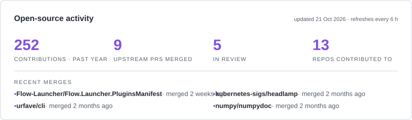

<div align="center">

# Utkarsh Tiwari

### Building AI products, Java backends, and secure cloud delivery workflows

[](https://utkarshalpha.github.io)
[](https://www.linkedin.com/in/utkaxh/)
[](mailto:utkarsh7854@gmail.com)
[](https://github.com/utkarshalpha)


</div>

I am a B.Tech Computer Science and Engineering student specializing in Data Science at Bennett University (2023–2027). My work spans **AI product management, backend engineering, and cloud/DevSecOps**: turning user problems into requirements, building testable applications, and automating their delivery. I focus on explainable AI, reliable APIs, and repeatable deployments.

- 🔭 Building AI products with deterministic validation around probabilistic models
- ⚙️ Working with Java/Spring Boot, payment-state workflows, CI/CD security gates, and GitOps staging deployments
- 🛠️ Latest build: a Java merchant-payments simulator with an AWS Jenkins DevSecOps pipeline; verified through staging on 28 October 2026
- 🎯 Interested in AI Product Management, Product Strategy, and Product Operations roles
- 🌱 Contributing to open source across the Python and JavaScript tooling ecosystems
- 📫 Open to product and AI engineering opportunities

## Skills & tools

**Product & delivery**

Product discovery, PRDs, requirements and acceptance criteria, RICE/Kano prioritization, stakeholder coordination, and cross-functional delivery.

**Languages**


**Backend engineering**


Java 21, Maven, REST APIs, Spring Data JPA, Flyway migrations, idempotency, database transactions, and automated API tests.

**Applied AI**


Agentic workflows, retrieval-augmented generation, source provenance, deterministic validation, and evaluation fixtures.

**Frontend**


**Databases**


**Cloud, CI/CD & GitOps**


AWS ECR and Systems Manager, rootless Docker, K3s, Helm, Argo CD, immutable image promotion, and staging smoke tests.

**DevSecOps project experience**

Gitleaks secret scanning; Semgrep SAST; OWASP Dependency-Check SCA; Trivy container scanning and SBOMs; Checkov IaC checks; Cosign image signing and verification; ZAP authenticated passive DAST.

## Selected work

| Project | What it demonstrates | Evidence |
|---|---|---|
| **Merchant Payments — AWS Jenkins DevSecOps Lab** *(private code)* | A Spring Boot simulator for INR payment orders, idempotent retries, simulated payments and refunds. Jenkins builds and scans the application, signs Docker images in ECR, and promotes verified digests to Argo CD/K3s staging with PostgreSQL. No real money transactions. | Build #17 passed end to end on 28 Oct 2026 · 19 application tests · 7 staging smoke checks · Trivy, Semgrep, Dependency-Check, Gitleaks, Checkov, Cosign and passive ZAP DAST |
| **[BenNest](https://bennest.vercel.app)** *(private code)* | A zero-brokerage marketplace for student housing, flatmates, and vehicle listings, with role-specific workflows, moderation, enquiries, messaging, and privacy-conscious authentication | Next.js · TypeScript · Supabase · email OTP · signed server sessions · [live product](https://bennest.vercel.app) |
| [ProdIntel AI](https://github.com/utkarshalpha/prodintel-ai) | Converts stakeholder feedback into evidence-traceable product decisions using a four-stage AI pipeline, deterministic validation, RAG, and decision provenance | [Live demo](https://appintel-ai-d9uewikfgwfaktmlnzrfrh.streamlit.app/) · 569 tests · 12 architecture decisions |
| [Tabyss](https://microsoftedge.microsoft.com/addons/detail/tabyss-%E2%80%94-know-your-scroll/bcnealjpndcccogjpceoaokeahmfdkha) | A privacy-first browser extension that computes your browsing personality entirely on-device — zero network requests, zero tracking | [Edge Add-ons](https://microsoftedge.microsoft.com/addons/detail/tabyss-%E2%80%94-know-your-scroll/bcnealjpndcccogjpceoaokeahmfdkha) · [source code](https://github.com/utkarshalpha/Tabyss) · JavaScript · on-device analytics |
| [AWS Remote Device Control (CDC)](https://github.com/utkarshalpha/ec2-remote-adb-scrcpy) | A standalone Windows desktop executable for controlling and diagnosing remote Android devices through secure EC2/SSH tunnels | Python · PySide6 · AWS EC2 · ADB/scrcpy · automated tests · Windows `.exe` distribution |
| [Multi-Agent Research Pipeline](https://github.com/utkarshalpha/multi-agent-research-pipeline) | Turns a research question into a structured, cited report using LangGraph agents, FastAPI, Claude, Tavily, arXiv, Qdrant, and deterministic offline mocks | CI · Docker · tests · evaluation fixtures · zero-key demo mode |

<div align="center">

<a href="https://github.com/search?q=author%3Autkarshalpha+is%3Apr+-user%3Autkarshalpha&type=pullrequests">
<picture>
  <source media="(prefers-color-scheme: dark)" srcset="metrics-dark.svg">
  
</picture>
</a>

</div>

## How I build

```text
User and stakeholder signals
        ↓
Clear product requirements
        ↓
Typed, testable system design
        ↓
Deterministic validation and evaluation
        ↓
Security gates and verified staging delivery
        ↓
Explainable product outcomes
```

I start with the user problem, define the expected behavior, and test it before delivery. I document design decisions and keep test results, security reports, and deployment evidence alongside the code.

## Connect

[Portfolio](https://utkarshalpha.github.io) · [LinkedIn](https://www.linkedin.com/in/utkaxh/) · [Email](mailto:utkarsh7854@gmail.com) · [GitHub](https://github.com/utkarshalpha)
